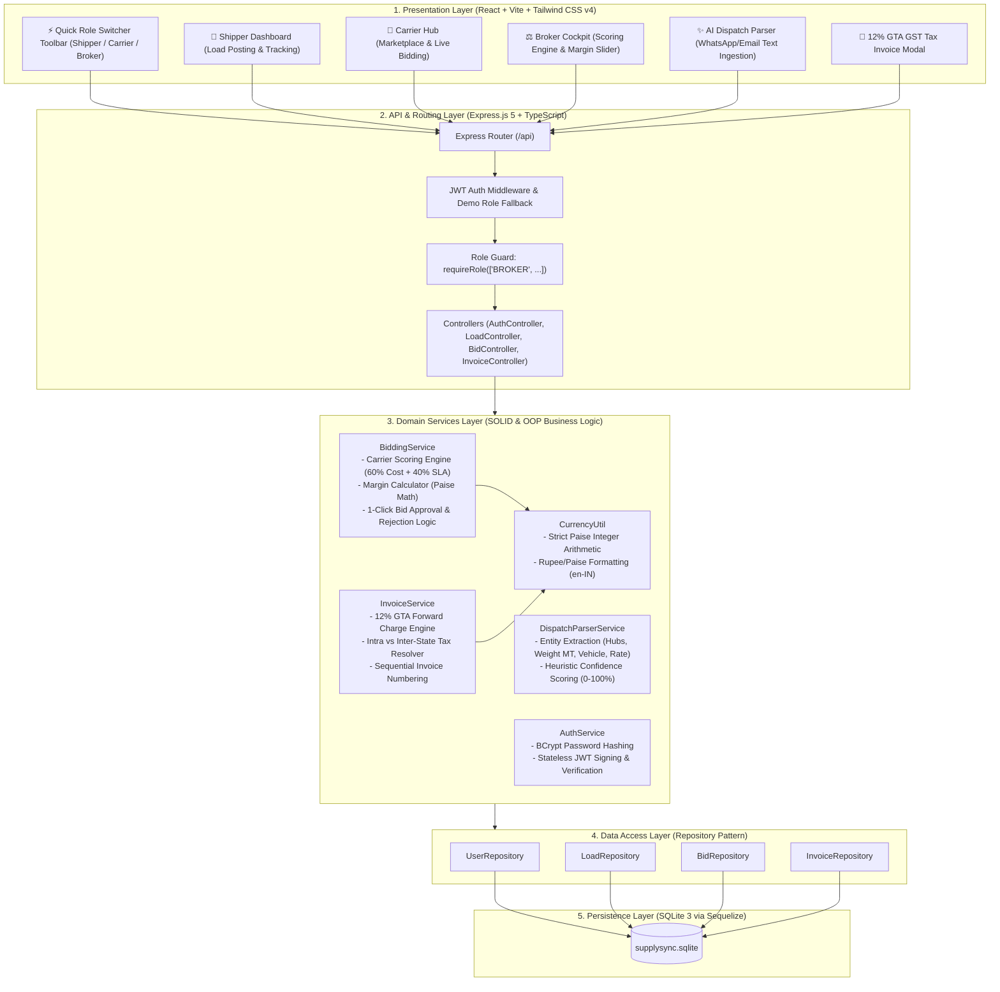
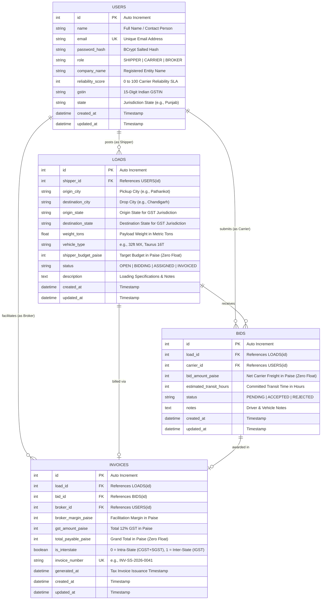

# SupplySync B2B — Architecture & Database Specification (Mission 1)

**System:** SupplySync B2B Logistics & Freight-Brokerage Portal  
**Document Purpose:** Technical Architecture & Database Design for Technical Interview Presentation  
**Author:** SupplySync Engineering Team  
**Standards:** Zero Floating-Point Math (Paise Integer Precision) & Indian GTA Forward-Charge GST (12%)

---

## 1. System Overview

SupplySync is an enterprise-grade B2B freight marketplace and brokerage platform designed for the Indian road logistics sector. It connects **Shippers** (manufacturers and distributors), **Carriers** (fleet operators and hauliers), and **Brokers** (facilitators managing margins, carrier scoring, and GST invoicing).

### Core Architectural Pillars
1. **Strict Layered MVC Architecture:** Clean separation of concerns from Controllers down to Data Access Repositories. Business logic (margin calculation, carrier ranking, GST computation) is strictly encapsulated in dedicated Service classes.
2. **Zero Floating-Point Financial Governance:** Currency values are never computed or stored using standard IEEE 754 floating-point representations. All freight rates, broker margins, and GST amounts are stored in SQLite as **integer Paise** (e.g., ₹42,000.00 = `4,200,000` Paise).
3. **Goods Transport Agency (GTA) Compliance:** Forward-charge GST rate of 12% (SAC: `996511`) dynamically decomposed into **6% CGST + 6% SGST** for intra-state transit or **12% IGST** for inter-state transit.
4. **Demo Ergonomics:** Integrated 1-click **Quick Role Switcher** toolbar for live presentations without repeated credential entry.

---

## 2. Layered MVC Architecture Diagram

---

## 3. Entity-Relationship (ER) Diagram

The database schema consists of the **4 core tables** engineered specifically for B2B freight brokerage, strict referential integrity, and zero floating-point financial precision:

---

## 4. Financial & Mathematical Algorithms

### A. Zero Floating-Point Precision Rule
All monetary amounts are converted to Paise integers upon entering the domain boundary and stored in integer columns:
$$\text{Paise} = \text{round}(\text{Rupees} \times 100)$$
$$\text{Rupees} = \frac{\text{Paise}}{100}$$

### B. Carrier Scoring & Ranking Engine (SOLID `BiddingService`)
When carriers bid on a load, the broker receives an automated composite score ranking the bids:
1. **Cost Score ($S_{\text{cost}}$):** Normalizes the carrier's bid against the lowest submitted bid on that load:
   $$S_{\text{cost}} = \text{round}\left( \frac{\min(\text{Bids})}{\text{Bid}_{\text{carrier}}} \times 100 \right)$$
2. **Reliability Score ($S_{\text{rel}}$):** Evaluated from the Carrier profile's `reliability_score` (0–100 scale based on historical on-time delivery SLAs).
3. **Composite Weighted Rank ($S_{\text{composite}}$):**
   $$S_{\text{composite}} = \text{round}(0.60 \times S_{\text{cost}} + 0.40 \times S_{\text{rel}})$$
   *The highest scoring carrier is flagged with the **★ Recommended Carrier** badge.*

### C. Indian GTA Forward-Charge Invoicing (`InvoiceService`)
Under Indian GST Notification 11/2017 for Goods Transport Agencies (GTA under forward charge, SAC 996511), standard GST is 12%:
- **Intra-State Corridor** ($\text{Origin State} = \text{Destination State}$, e.g. Punjab $\rightarrow$ Punjab):
  $$\text{CGST} = \text{round}\left(\frac{\text{SubtotalPaise} \times 6}{100}\right)$$
  $$\text{SGST} = \text{round}\left(\frac{\text{SubtotalPaise} \times 6}{100}\right)$$
  $$\text{IGST} = 0$$
- **Inter-State Corridor** ($\text{Origin State} \neq \text{Destination State}$, e.g. Punjab $\rightarrow$ Delhi):
  $$\text{IGST} = \text{round}\left(\frac{\text{SubtotalPaise} \times 12}{100}\right)$$
  $$\text{CGST} = 0, \quad \text{SGST} = 0$$
- **Grand Total Payable:**
  $$\text{TotalPayablePaise} = \text{SubtotalPaise} + \text{GstAmountPaise}$$

---

## 5. Pre-Seeded Indian Logistics Corridors & Demo Accounts

### Demo Accounts (`SeedService.ts`)
| Persona | Name | Organization | Reliability SLA | GSTIN |
| :--- | :--- | :--- | :--- | :--- |
| **Shipper** | Gurpreet Singh | Punjab Agro Exporters Ltd | 90% | `03AABCP8921A1Z2` |
| **Carrier 1** | Rajesh Sharma | SpeedTrans Logistics | **95%** (High SLA) | `03AAACS4512C1Z4` |
| **Carrier 2** | Manish Verma | Northern Express Hauliers | **82%** (Mid SLA) | `07AAACN1289D1Z8` |
| **Broker** | Aditya Oberoi | SupplySync Freight Solutions | 100% | `03AABCS1429B1Z0` |

### Pre-Seeded Freight Corridors
1. **Pathankot $\rightarrow$ Chandigarh:** 240 km | 22 MT Cement | Taurus 16T | Budget: ₹32,000.00 (`3,200,000` Paise). Active bids from Carrier 1 (₹29,500) and Carrier 2 (₹31,000).
2. **Ludhiana $\rightarrow$ Delhi:** 310 km | 18 MT Auto Parts | 32ft MX | Budget: ₹42,000.00 (`4,200,000` Paise). Active bids from Carrier 1 (₹38,500) and Carrier 2 (₹40,500).
3. **Amritsar $\rightarrow$ Jaipur:** 590 km | 16 MT Basmati Rice | 14 Wheeler | Budget: ₹54,000.00 (`5,400,000` Paise). Active bids from Carrier 1 (₹51,000) and Carrier 2 (₹49,500).
4. **Mumbai $\rightarrow$ Pune:** 150 km | 9.5 MT Imported FMCG | 20ft Container | Budget: ₹21,000.00 (`2,100,000` Paise). Status: `INVOICED` with invoice `INV-SS-2026-0041`.

---

## 6. Technical Interview Presentation Checklist

- [x] **Layered Architecture:** Emphasize that Controllers are thin request coordinators, Services contain all business math, and Repositories isolate database queries.
- [x] **Zero Floating-Point Proof:** Show that all monetary columns in SQL have `INTEGER` types (Paise). No `FLOAT` or `DOUBLE` is ever used for rates or taxes.
- [x] **Multi-Carrier Ranking:** Walk through the 60/40 weighted formula balancing freight cost and carrier historical reliability.
- [x] **Indian Logistics Domain Knowledge:** Highlight the distinction between Intra-state (CGST + SGST) and Inter-state (IGST) for Goods Transport Agencies.
- [x] **AI Dispatch Parser:** Demonstrate parsing unstructured WhatsApp/Email strings into verified relational records in under 50ms.
