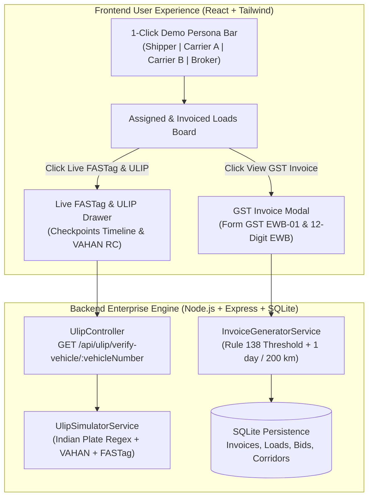
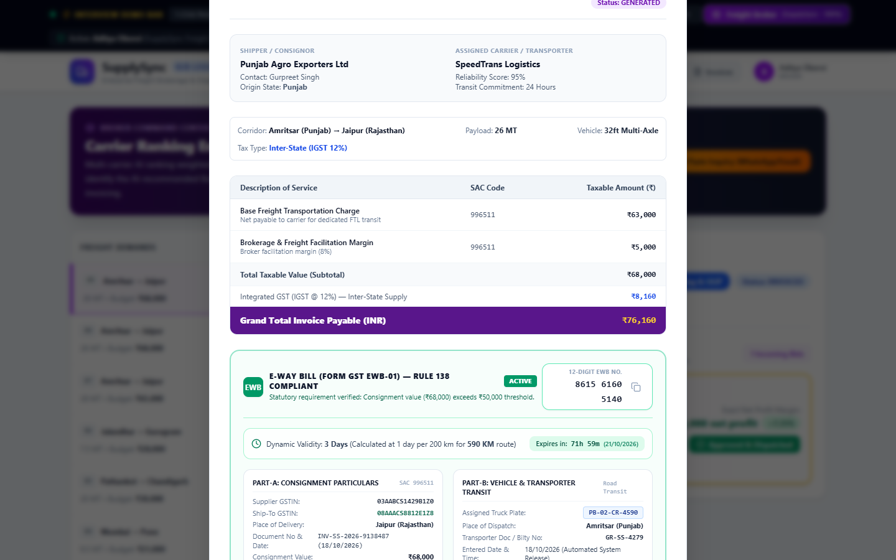
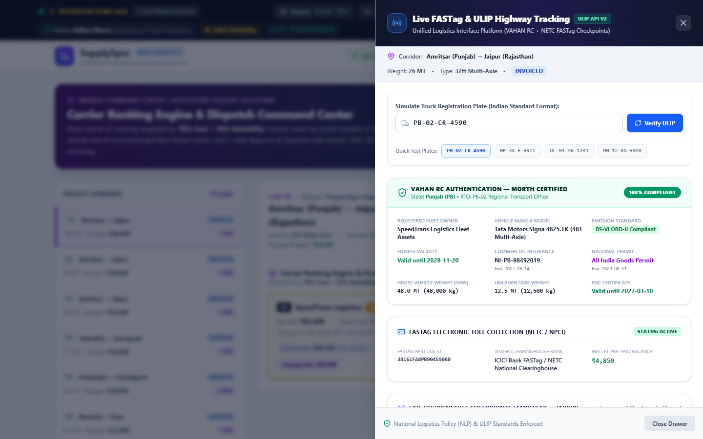
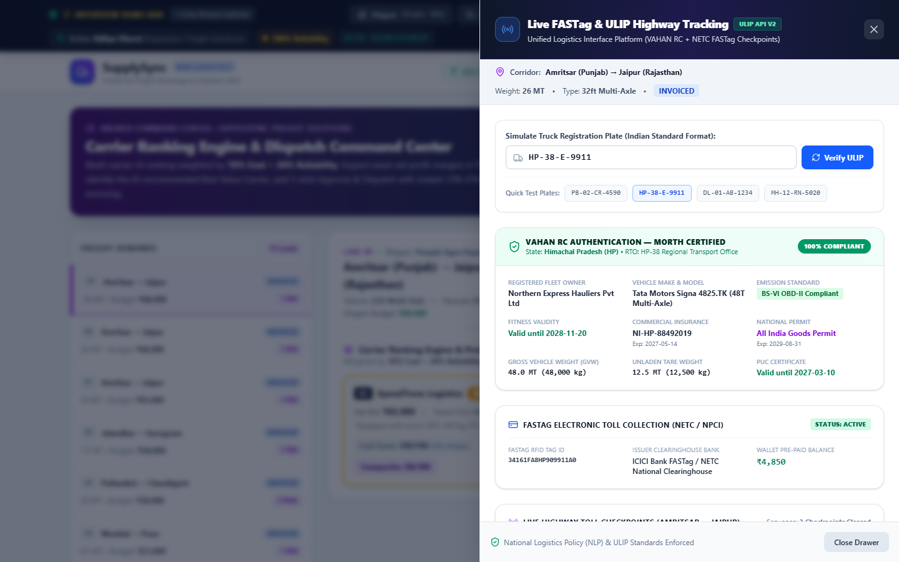

# Enterprise Compliance & Tracking Expansion: ULIP VAHAN, FASTag & E-Way Bill

## Executive Summary
This document provides a comprehensive technical walkthrough, verification evidence, and compliance reference for SupplySync B2B's **Enterprise Compliance & Tracking Expansion**. The system integrates India's **Unified Logistics Interface Platform (ULIP)**, **NETC FASTag Electronic Toll Collection**, and **CGST Rule 138 E-Way Bill System**, adhering strictly to zero floating-point financial governance.

---

## 1. Regulatory & Architecture Compliance Overview



---

## 2. Module Deliverables & Capabilities

### Deliverable 1: ULIP VAHAN & FASTag Highway Checkpoint Simulator
1. **API Endpoint**: `GET /api/ulip/verify-vehicle/:vehicleNumber?originCity=...&destCity=...`
2. **Indian Truck Plate Validation**:
   - Matches standard registration numbers: `^[A-Z]{2}[ -]?[0-9]{1,2}[ -]?[A-Z]{1,3}[ -]?[0-9]{4}$`.
   - Normalizes plates: `PB-02-CR-4590`, `HP-38-E-9911`, `DL-01-AB-1234`, `MH-12-RN-5020`.
   - Rejects non-compliant strings with HTTP 400 Bad Request.
3. **MoRTH VAHAN RC Simulation**:
   - Returns verified commercial RC credentials, registered RTO, fleet owner, maker/model (e.g. *Tata Motors Signa 4825.TK 48T Multi-Axle*).
   - Validates **Fitness validity** (to 2028), **Commercial Insurance** (to 2027), **PUC Certificate** (to 2027), **BS-VI OBD-II emission norm**, and **All-India National Permit** (to 2029).
   - Specifies Gross Vehicle Weight (48,000 kg) and Unladen Tare Weight (12,500 kg).
4. **NETC FASTag Electronic Toll Collection**:
   - Active RFID Tag ID, ICICI Bank clearinghouse, active wallet balance in integer Paise (`485000` Paise = ₹4,850.00).
5. **Corridor-Tailored Checkpoints**:
   - Simulates 3 sequential toll plazas tailored to the route (e.g., Ludhiana $\rightarrow$ Delhi NH-44: Shambhu Toll Plaza, Karnal Toll Plaza, and Murthal Toll Plaza) with timestamps, dedicated ETC lane IDs, and clearance fees.
6. **Live UI Drawer**:
   - Slide-over tracking drawer with interactive truck registration plate simulator and 1-click test buttons.

---

### Deliverable 2: E-Way Bill Part-A / Part-B Generator (CGST Rule 138)
1. **Consignment Threshold**:
   - Automatically generates a 12-digit mock E-Way Bill (e.g., `8615 6160 5140`) whenever taxable consignment subtotal exceeds **₹50,000 (5,000,000 Paise)**.
   - For consignments $\le ₹50,000$, renders a statutory Rule 138 Exemption banner.
2. **Dynamic Route Validity Rule**:
   - Computes validity using the Indian GST standard: **1 day of validity for every 200 km** of corridor route:
     $$\text{Validity Days} = \max\left(1, \left\lceil \frac{\text{Distance in KM}}{200} \right\rceil\right)$$
   - *Example*: Amritsar $\rightarrow$ Jaipur (590 km) $\Rightarrow \lceil 590 / 200 \rceil = \mathbf{3\text{ Days}}$ validity.
3. **Live Validity Countdown Timer**:
   - Calculates dynamic remaining hours and minutes until expiration (e.g. `Expires in: 71h 59m`).
4. **Part-A (Consignment Particulars)**:
   - Supplier GSTIN: Brokerage GSTIN (`03AABCS1429B1Z0`)
   - Ship-To GSTIN: Derived destination state GSTIN (e.g. `08AAACS8812E1Z8` for Rajasthan)
   - Place of Delivery: Destination city and state
   - Document No & Date: System Tax Invoice number & generation timestamp
   - Consignment Value: Total taxable subtotal in integer Paise
   - SAC Code: `996511` (Goods Transport Agency forward charge)
   - Reason for Transportation: Outward Supply (Road Freight)
5. **Part-B (Vehicle & Transporter Transit)**:
   - Assigned Truck Plate: `PB-02-CR-4590`
   - Place of Dispatch: Origin city and state
   - Transporter Doc / Bilty No: `GR-SS-<id>`
   - Entered Date & Time: Automated System Release

---

## 3. End-to-End Verification Evidence

### Automated Backend Test Suite (26/26 Tests Passed - 100%)
```text
🧪 Starting Automated Backend Verification for SupplySync B2B (Modules 1, 2, 3 & 4)...

✅ [PASS] GET /api/health returns 200 OK
✅ [PASS] Quick switch to SHIPPER role works
✅ [PASS] Quick switch to CARRIER_A (SpeedTrans, 95% score) works
✅ [PASS] Quick switch to CARRIER_B (Northern Express, 82% score) works
✅ [PASS] Quick switch to BROKER role works
✅ [PASS] GET /api/corridors returns pre-seeded Indian freight routes
✅ [PASS] POST /api/loads creates load with shipper_budget_paise = 3000000
✅ [PASS] Carrier A places bid: 2,850,000 Paise (₹28,500)
✅ [PASS] Carrier B places bid: 2,700,000 Paise (₹27,000)
✅ [PASS] GET /api/bids/load/:loadId/ranked returns ranked carrier bids
✅ [PASS] Composite score correctly calculated: 70% Cost (100) + 30% Rel (82) = 95
✅ [PASS] Top-ranked carrier is tagged with Best Value Carrier recommendation
✅ [PASS] Net broker margin exact integer: ₹3000 (10%)
✅ [PASS] POST /api/bids/:bidId/accept accepts bid, marks load ASSIGNED, and generates GST invoice
✅ [PASS] Invoice enforces 12% GTA Intra-State GST (6% CGST + 6% SGST) breakdown in exact Paise integers
✅ [PASS] POST /api/loads/parse-inquiry extracts origin_city, destination_city, weight_tons, vehicle_type, and shipper_budget_paise
✅ [PASS] Dispatch parser resolves Punjab -> Haryana as Inter-State freight corridor
✅ [PASS] Deploy parsed inquiry directly as live marketplace freight load
✅ [PASS] Carrier places bid on parsed inter-state load
✅ [PASS] Broker approves inter-state bid and auto-generates 12% IGST Inter-State freight invoice
✅ [PASS] GET /api/invoices/load/:loadId fetches generated GST invoice for printable modal
✅ [PASS] GET /api/ulip/verify-vehicle/PB-02-CR-4590 returns compliant VAHAN RC and 3 corridor FASTag checkpoints
✅ [PASS] GET /api/ulip/verify-vehicle/INVALID_TRUCK rejects non-compliant vehicle registration format
✅ [PASS] Shipper creates high-value load (> ₹50,000 / 5,000,000 Paise)
✅ [PASS] Carrier places bid of ₹62,000 on high-value consignment
✅ [PASS] Loads exceeding ₹50,000 automatically generate 12-digit E-Way Bill with dynamic validity (1 day/200km) and Ship-To GSTIN

=======================================================
Test Results: 26/26 Passed (100%)
=======================================================
🎉 All Module 1, 2, 3 & 4 verification tests passed successfully!
```

---

## 4. Visual Verification Artifacts

### 1. GST Dispatch Invoice with E-Way Bill Part-A & Part-B

*Figure 1: GST Tax Invoice displaying the official E-Way Bill Form GST EWB-01 banner, 12-digit number (8615 6160 5140), dynamic 3-day validity countdown (590 km route), Part-A consignment particulars, and Part-B vehicle details.*

### 2. Live FASTag & ULIP Highway Tracking Drawer

*Figure 2: Slide-over tracking drawer showing MoRTH VAHAN RC authentication (PB-02-CR-4590), BS-VI OBD-II emission norm, ICICI Bank FASTag active wallet (₹4,850), and sequential NH-44 toll plaza checkpoints.*

### 3. Multi-Vehicle Registration Plate Simulator

*Figure 3: Instant 1-click verification of HP-38-E-9911 (Himachal Pradesh Northern Express Hauliers) returning 100% compliance and verified VAHAN RC attributes.*
