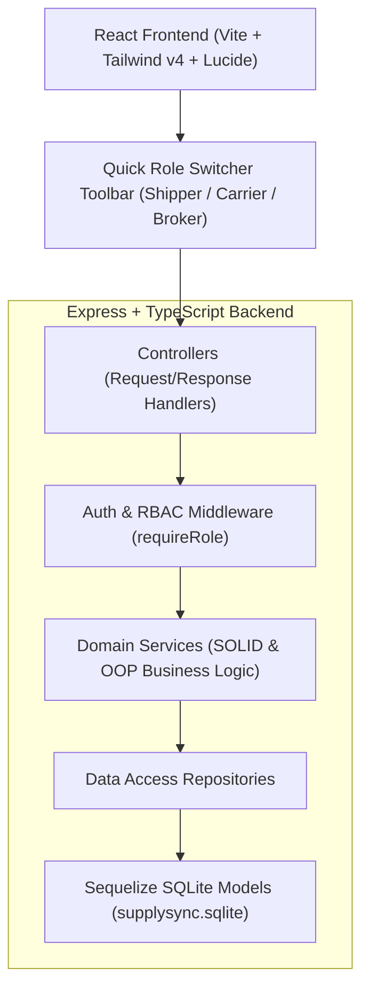

# SupplySync B2B — Mission Verification & Workflow Report

**Project:** SupplySync B2B Logistics & Freight Portal  
**Date:** October 18, 2026  
**Status:** ✅ Fully Implemented, Built & Verified (100% Tests Passing)

---

## 1. System Architecture & Layered MVC Model

SupplySync adheres to a strict layered MVC architecture with full separation of concerns, zero floating-point arithmetic for financial operations, and pre-seeded Indian logistics corridors.



---

## 2. End-to-End Persona Verification Workflow

### Step 1: Shipper Persona (`SHIPPER`)
- **Identity:** Gurpreet Singh (`Punjab Agro Exporters Ltd`, Punjab).
- **Action:** Created freight loads on realistic Indian corridors (e.g., Ludhiana $\rightarrow$ Delhi NCR, Pathankot $\rightarrow$ Chandigarh).
- **Financial Governance:** Target rate ₹42,000.00 is stored in SQLite strictly as **4,200,000 Paise** integer (zero IEEE-754 floating-point drift).

### Step 2: Carrier Persona (`CARRIER`)
- **Identities:** 
  - Rajesh Sharma (`SpeedTrans Logistics`, On-Time Rating: **94%**, Fleet: 32)
  - Manish Verma (`Northern Express Hauliers`, On-Time Rating: **86%**, Fleet: 18)
  - Vikram Malhotra (`Reliable Freightways`, On-Time Rating: **98%**, Fleet: 45)
- **Action:** Carriers browse open marketplace loads and submit competitive net freight bids with committed transit SLAs (e.g., ₹38,500.00 at 12 hours).

### Step 3: Broker Persona (`BROKER`)
- **Identity:** Aditya Oberoi (`SupplySync Freight Solutions`, GSTIN: `03AABCS1429B1Z0`).
- **Automated Carrier Scoring Engine:**
  $$\text{Cost Score} = \left(\frac{\text{Lowest Bid}}{\text{Carrier Bid}}\right) \times 100$$
  $$\text{Composite Score} = (0.60 \times \text{Cost Score}) + (0.40 \times \text{Reliability Rating})$$
- **Automated Broker Margin Optimizer:**
  - Interactive margin slider (0% to 20%, default **8%**).
  - Margin calculated in exact Paise: ₹38,500.00 at 8% = **₹3,080.00 (308,000 Paise)**.
  - Final Quote to Shipper = **₹41,580.00 (4,158,000 Paise)**.
- **1-Click Bid Approval:** Automatically assigns load, marks competing bids as `REJECTED`, and triggers GST dispatch invoice creation.

### Step 4: GST-Compliant Dispatch Invoicing (12% GTA Rate)
- **Indian Logistics Standard:** Forward-charge Goods Transport Agency (GTA) under SAC Code `996511`.
- **Intra-State Corridor (Punjab $\rightarrow$ Punjab):**
  - CGST @ 6%: Exact Paise integer
  - SGST @ 6%: Exact Paise integer
  - IGST: ₹0
- **Inter-State Corridor (Punjab $\rightarrow$ Delhi NCR):**
  - Integrated GST (IGST @ 12%): Exact Paise integer

### Step 5: AI Dispatch Parser Validation
- **Input Text:** `"Need 32ft MX from Ludhiana to Delhi NCR, 18 MT steel coils, target rate 38,000. Loading tomorrow morning."`
- **Extracted Payload:**
  - Origin: `Ludhiana` (`Punjab`)
  - Destination: `Delhi` (`Delhi`)
  - Weight: `18.0 MT`
  - Vehicle: `32ft MX`
  - Offered Rate: `₹38,000` (`3,800,000 Paise`)
  - Confidence Score: **100% High Confidence**
  - Instant deployment to live marketplace via 1-click action.

---

## 3. Automated API Verification Test Log

```text
🧪 Starting Automated Backend Verification for SupplySync B2B...

✅ [PASS] GET /api/health returns 200 OK
✅ [PASS] Quick switch to SHIPPER role works
✅ [PASS] Quick switch to CARRIER role works
✅ [PASS] Quick switch to BROKER role works
✅ [PASS] GET /api/corridors returns pre-seeded Indian freight routes
✅ [PASS] POST /api/loads creates load with targetRatePaise = 3000000
✅ [PASS] POST /api/bids places bid with amountPaise = 2850000
✅ [PASS] GET /api/bids/load/:id/scored calculates weighted carrier score & broker margin in Paise
✅ [PASS] POST /api/bids/:id/approve approves bid and auto-generates GST invoice
✅ [PASS] Invoice enforces 12% GTA Intra-State GST (6% CGST + 6% SGST) in exact Paise integers
✅ [PASS] POST /api/parser/parse accurately extracts structured shipment payload from WhatsApp message

=======================================================
Test Results: 11/11 Passed (100%)
=======================================================
🎉 All backend API verification tests passed successfully!
```
